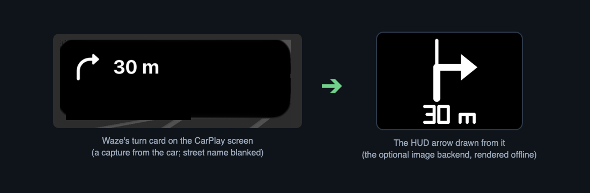

# waze-hud

Waze on a BMW's instrument cluster and its head-up display, for the iDrive 7
head unit (MGU), installed from the
[mgu Store](https://github.com/robertnisipeanu/mgu-store).

Waze sends CarPlay no route guidance, so BMW's HUD shows no arrows for it.
This project reads Waze's next turn from the CarPlay picture and sends it to
the car's own navigation interface (SOME/IP `ProjectedModeGuiding`), the way
CarPlay sends Apple Maps' and Google Maps' guidance: **BMW's own HUD arrow,
distance and street name, for Waze**. The CarPlay (or Android Auto) map is
shown on the instrument cluster as well, at 15 frames a second.


*How it works: the map goes to the instrument cluster as video; the next turn
is read from the CarPlay screen and handed to BMW's own HUD.*



*Left, Waze's turn card as captured on the car (the test image the reader is
checked against). Right, the arrow drawn from it by the optional `image`
backend, rendered offline with
[`hud_draw.cpp`](native/jap-waze-on-cluster/src/hud_draw.cpp); the default `native`
backend shows BMW's own arrow, distance and street name instead. Not a photo
of the HUD.*

> **Use at your own risk.** This project patches programs on your car's head
> unit. It is not affiliated with or endorsed by BMW AG, Apple, Google or
> Waze; their names are used only to say what it works with. It may affect
> your warranty. The HUD arrow is read from the screen's pixels and can be
> wrong, late or missing: follow Waze, not the HUD, and keep your eyes on
> the road.

| Path | |
|---|---|
| [`native/jap-waze-on-cluster`](native/jap-waze-on-cluster) | the tool: the carplay and aapd patches, the map capture for the cluster, the HUD arrows (`hudguide`) |
| [`apps/jap_waze_cluster`](apps/jap_waze_cluster) | **Waze HUD**, the iDrive app: status, Enable and Disable, Android Auto, Logs, and the choice when another Waze on cluster is installed |
| [`native/cluster-render`](native/cluster-render) | the shared cluster renderer, kept here to build against; installed from its own source |
| [`release`](release) | builds the Store catalog |

## What's new in 1.2.0

- **The cluster map at 15 fps.** A fifth edit to `carplay` asks the phone
  for at most 15 frames a second on the cluster, the rate the cluster shows
  anyway. On the test car the decode went from 41 % to 16 % of a CPU core.
  It follows the rules of the other edits: tested build only, left alone on
  other cluster codings, a second press on untested builds, reverted on
  removal and by boot recovery.
- **The street name.** The street from the CarPlay card goes to the HUD,
  under the distance. Like the distance, it needs templates you make from
  your own copy of SF Pro (see Install).
- **The turn kept while CarPlay is hidden.** With another app on the centre
  screen, the last turn stays on the HUD and its distance counts down with
  the vehicle speed, read by a new small service
  (`jap-waze-on-cluster-speedd`). It needs the route calibration below and
  is off until then.
- **The route traced on the cluster map.** A kept turn ends once the map
  shows it is passed, or after 10 minutes at the latest.
- **The next turn from the map** (off by default, `hud_geo_next = 1`):
  after a passed turn, a plain left or right read from the map, with no
  distance.

## Requirements

- A BMW with an iDrive 7 head unit (MGU, ID7), the 12.3" centre screen
  (1920x720) and CarPlay (Android Auto for the cluster map only, where the
  car supports it).
- The 12.3" instrument cluster coded `KI_KOMBI_VARIANT` 7, the one without
  the stock CarPlay cluster map. On other codings the tool leaves CarPlay as
  it is and the app says `not supported on this car`.
- The mgu Store with `mgu-deploy` 0.7.11 or later (the Store brings it).
- Two Store sources: this repository and `robertnisipeanu/idrive-apps`,
  which publishes `cluster-render` 0.3.7 or later, the renderer the tool
  requires.

These minimums are the same for `jap-waze-on-cluster` 1.2.0 as for 1.1.1.
The app (**Waze HUD** 1.0.2) is unchanged and works with either.

### Tested on

One BMW X5 (G05), with an iPhone running Waze over CarPlay:

| | |
|---|---|
| Head unit | MGU, firmware P18_23w44.2-1-3 |
| `carplay` | 22.28.3+gitr624+993efc1-r0.14 (build-id `5de62156…`) |
| `aapd` | 22.39.3+gitrAUTOINC+d5a1db18c4-r0 |
| Cluster coding | `KI_KOMBI_VARIANT` 7 |

Only these builds are patched as installed. On any other `carplay` build the
install leaves it untouched and the app shows `untested carplay build`;
**Enable map** then patches it only after a second press, since no car has
run that build patched (a CarPlay crash restarts the head unit, and boot
recovery restores the original after two). Reports from other cars and
firmware are welcome in the issues.

Version 1.2.0 has run on the same car (`carplay` 22.28.3) since 2026-11-08:
all its services are up, the vehicle speed is read and the street templates
load. It has not been validated on a drive yet. The route features (the
kept turn, the route trace, the next turn from the map) need a calibration
for each car and have only been checked against frames recorded on this
one.

## Install

1. In the Store, add the GitHub source `robertnisipeanu/idrive-apps` on
   Releases (`robertnisipeanu/idrive-apps:releases`), if it is not there.
2. Add the GitHub source `JustAnotherPU/waze-hud` on Releases
   (`JustAnotherPU/waze-hud:releases`).
3. Install **Waze HUD**. The Store installs what it requires first:
   `cluster-render`, then the tool `jap-waze-on-cluster`.
4. Restart the head unit when the Store says so: the CarPlay patch takes
   effect at the next start.
5. Set **Instrument cluster > Central display area** to **Map view** and
   start a route in Waze.

The HUD shows Waze's arrow, distance and street, read from the CarPlay card
on the centre screen. Without the card (Waze's own screen hidden, another
app on top), it shows no arrow until the route calibration below is done.

### Templates for the distance and the street

No font file and no generated templates ship here. The distance and the
street are read with templates you make from your own copy of SF Pro (the
variable font, with weight and optical size); without them the arrow shows
alone.

1. On a computer with Python 3 and Pillow, run
   `python3 native/jap-waze-on-cluster/tools/hud_font_templates.py hud-templates <SF Pro font file>`.
2. Copy the `hud-templates/` folder to
   `/var/opt/jap-waze-on-cluster/hud-templates/` on the head unit.
3. Restart `jap-waze-on-cluster.service`. Its log says how many templates
   loaded.

The templates are renders of Apple's font: keep them on your own car, and
never commit or share them.

### Route calibration (optional, per car)

The turn kept while CarPlay is hidden needs the colour of Waze's route line
on your car's cluster map. Until it is set (`hud_route_uv`, empty by
default) that feature is off.

1. With Waze guiding on the cluster, run
   `jap-waze-on-cluster -c /var/opt/jap-waze-on-cluster/current/jap-waze-on-cluster.conf run map-dump`
   on the head unit a few times: a straight road, a turn, day and night.
2. Stop the navigation and run it a few more times.
3. Copy the `map-*.yuv` files from `/tmp/jap-woc-hud/` to a computer and run
   `python3 native/jap-waze-on-cluster/tools/route_calibrate.py --on <dumps while guiding> --off <the others>`.
4. Put the three lines it prints in
   `/var/opt/jap-waze-on-cluster/jap-waze-on-cluster.local.conf` and restart
   `jap-waze-on-cluster.service`.
5. Check `route` in `/run/jap-waze-on-cluster/probe.txt`: 1 with the
   navigation on, 0 with it off.

Recording the calibration pairs (map frames in `/tmp/jap-woc-hud/` and
`/tmp/jap-woc-hud-pairs/pairs.csv`, for comparing the map with the card) is
off too, until you create the flag file
`/tmp/jap-woc-hud-dump` on the head unit. The drawn-image backend
(`hud_backend = image`) is an optional fallback.
[The tool's README](native/jap-waze-on-cluster/README.md#hud-arrows) has the
details.

## If robertnisipeanu's Waze on cluster is installed

Both versions patch CarPlay, so only one can run. This one uses its own ids,
paths and units, so installing it overwrites nothing of the other; while the
other is installed it stays dormant: no patch, no capture, no HUD guidance.
Open **Waze HUD** and a pop-up says the other version is installed and both
patch CarPlay:

- **Remove it and use Waze HUD**: the tool removes the other app and tool
  through the deploy tool (as the Store does, its own removal reverting its
  patch), then turns this one on. Restart the head unit to finish. This
  removal has not been tested on a car yet; removing the other version in
  the Store yourself, then installing this one, is the tested path.
- **Cancel**: nothing changes; this one stays off. The pop-up asks again the
  next time the app opens; the page has the same choice as a button.

`cluster-render` is shared and stays installed.

**Who can ask for it.** The tool's root helper listens on
`/dev/shm/jap-waze-on-cluster/patch.sock` (root:tm_oap_app, 0660), the same
model as the Store's mgu-updater socket: any installed OAP app can ask it to
apply or revert the patch, remove the other Waze on cluster (`takeover`) or
restart the head unit. Install apps only from sources you trust.

## Remove or roll back

In the Store, remove **Waze HUD**, then `jap-waze-on-cluster`; its removal
reverts the CarPlay and Android Auto patches (the fps edit with the
others), and the next head-unit start runs the original programs.
`cluster-render` and `mgu-deploy` stay. An update that does not work can be
undone in the Store (Undo update) while the previous version is kept. Going
back from 1.2.0 to 1.1.1 runs 1.2.0's removal step first (all five edits
reverted, the speed service taken out), then 1.1.1 writes its own four-edit
patch, active from the next start. That has not been tried on a car yet.

## Not tested yet

- The arrow without the glyph templates (it is meant to show without a
  distance or a street).
- The route features (the kept turn, the route trace, the next turn from
  the map) on other cars, phones and Waze versions, and in daylight.
- The kept turn without CarPlay in long tunnels (the map stands still
  there, so only the vehicle speed moves the distance).
- Left-hand traffic (UK, Ireland, Australia, Japan): the HUD guidance is
  sent as right-hand traffic, so roundabout exits may be drawn mirrored.
- Handing over between Waze and Apple Maps (or Google Maps) during one drive.
- A route in BMW's own navigation while Waze guides on the phone (the HUD
  guidance is meant to give way to it).
- Removing the other Waze on cluster from the pop-up, on the car (tested
  against a fake deploy tool).
- The pop-up's second button on the car (the page button is the fallback).

## Build and test

```sh
make -C native/jap-waze-on-cluster test        # host tests (Node, C++)
make -C native/jap-waze-on-cluster target      # the unit's binary, in Docker
node apps/jap_waze_cluster/tools/test_control.js
node apps/jap_waze_cluster/tools/test_page.js
node release/test/release_test.js
node release/release.js build                  # artifacts and catalog.json in release/out/
```

## License

GPL-3.0-or-later ([`LICENSE`](LICENSE)), unless a file's SPDX header says
otherwise, derived from
[robertnisipeanu/idrive-apps](https://github.com/robertnisipeanu/idrive-apps)
([`NOTICE`](NOTICE) lists the changes). cluster-render's `include/`,
`client/`, `kit/`, `js/cluster_render_client.js` and `PROTOCOL.md` are
MPL-2.0 ([`LICENSES/MPL-2.0.txt`](LICENSES/MPL-2.0.txt)); third-party files
keep their own licenses (the RAMSES and vsomeip interfaces, MPL-2.0; the
Intel Media SDK headers, MIT; Project Nayuki's QR code generator, MIT).
